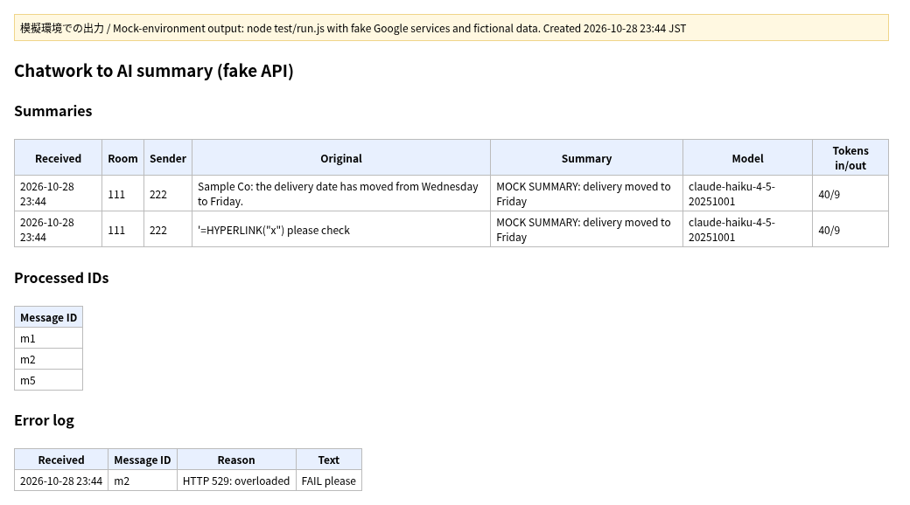

# Chatwork to AI summary: summarize each chat message with Claude and log it in Google Sheets (Google Apps Script)

For a team that gets many Chatwork messages from clients or partners and wants a short, searchable summary of each one in a spreadsheet.

**Live check:** on 2026-10-28 (JST) the summary step was run against the real Anthropic API with `claude-haiku-4-5-20251001`, using 3 short fictional Japanese messages; see `runs.md`. The tests and the screenshot above use a fake API.

**Screenshot note:** this screenshot was produced in a mock environment (模擬環境での出力), not in a live Google account. The AI API is also replaced with a fake that returns a fixed "MOCK SUMMARY" text.

The image above is the real output of `node test/run.js`, run in a mock environment where Google services and the AI API are replaced with simple fakes. All names and data are fictional.

**What changes:** each new Chatwork message becomes a sheet row with the time, room, sender, original text and a one-sentence summary written by an AI model, so nobody has to read back through the chat to find what was agreed.

## The problem
Important details (dates, changes, requests) get buried in long chat threads, and copying them into a sheet by hand is slow and easy to miss.

## How it works
1. The script is deployed as a web app and its URL is set as the Chatwork webhook URL
2. `doPost` checks the shared secret in the URL; a wrong or missing secret is refused
3. The message is read from the Chatwork webhook (`message_created` or `mention_to_me`), and Chatwork tags such as `[To:...]` are removed
4. The text is sent to the Anthropic Messages API with `UrlFetchApp`; the model returns a one-sentence summary
5. Time, room, sender, original, summary, model and token counts go to `Summaries`; failures go to `Error log`
6. Each message ID is stored in `Processed IDs`, so a resent webhook is not summarized (or billed) twice

## Setup
1. Open the spreadsheet, then Extensions > Apps Script, and add the files from `src/` (including `appsscript.json`)
2. Project Settings > Script properties, add:
   - `WEBHOOK_SECRET`: a long random value
   - `ANTHROPIC_API_KEY`: your Anthropic API key
   The key is read only from Script Properties. Never paste it into code or commit it.
3. Edit `src/Config.gs` if needed: model, prompt, length limit, sheet names
4. Deploy > New deployment > Web app, then in Chatwork set `<web app URL>?key=<secret>` as the webhook URL

## Errors and records
- Wrong secret: nothing is written and the API is not called
- API key missing, or the API returns an error: the message and the reason are kept in `Error log`
- Very long messages are cut to `CONFIG.maxInputChars` before sending, to keep cost predictable
- Two messages at the same moment are handled one at a time with `LockService`
- Values that start with `=`, `+`, `-` or `@` are stored as text, not formulas

## Files
| File | Role |
|---|---|
| `src/Config.gs` | Everything that changes per client |
| `src/Lib.gs` | Logic with no Google services (what the tests cover) |
| `src/Main.gs` | Entry point, API call and Google service calls |
| `test/run.js` | Mock-environment tests; `test/mock_gas.js` holds the fake services |
| `tools/render_png.py` | Builds the image above from the test output |
| `tools/live_run.js` | Runs `src/` once against the real API (key from the `ANTHROPIC_API_KEY` environment variable) |
| `runs.md` | Record of the live calls |

## Build notes
- Tests: `node test/run.js` runs 10 checks in the mock environment with a fake API (no network, no key needed), all OK
- The company and person names in the test messages (e.g. サンプル商事の山田) are fictional, for testing only.
- To use another AI provider, only `summarize_`, `buildRequest_` and `parseResponse_` change

## About me
Reypage, Google Apps Script automation. I spent about 3.5 years building GAS tools for internal operations at a company in a TSE Prime-listed group. One system I designed was used by about 2,700 people, and in a user survey people answered that it saved them about 1 to 2 hours of paperwork per person per day.

## License
MIT
